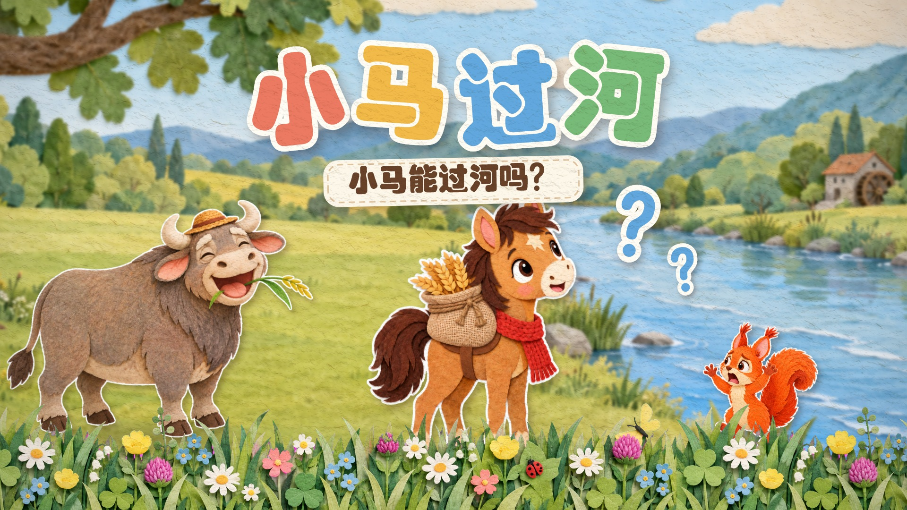
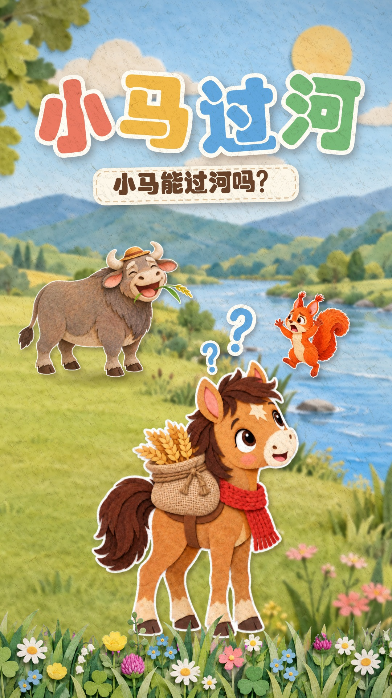
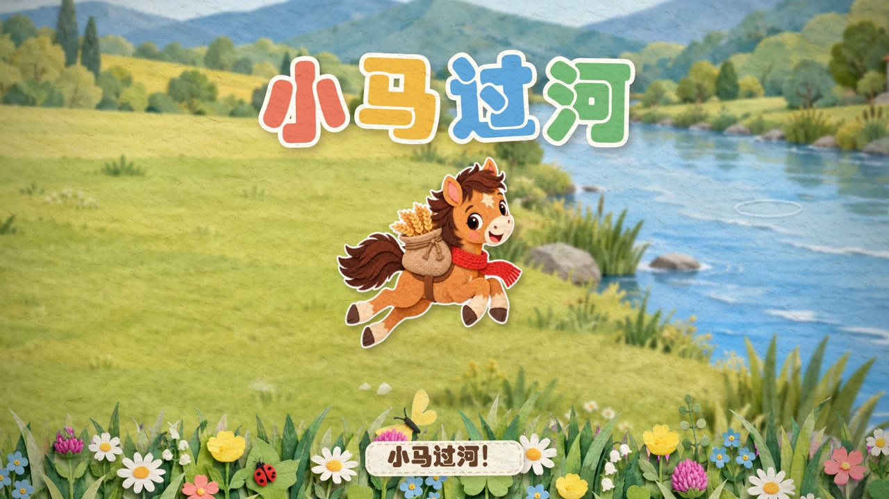
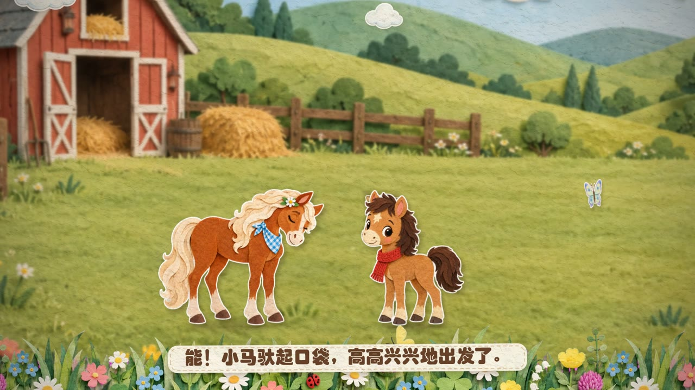
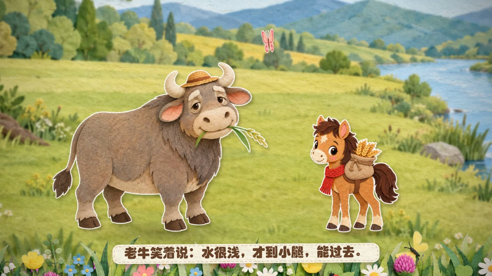
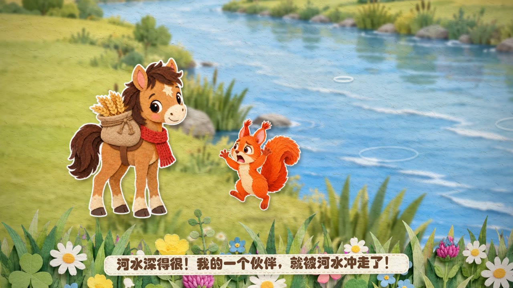
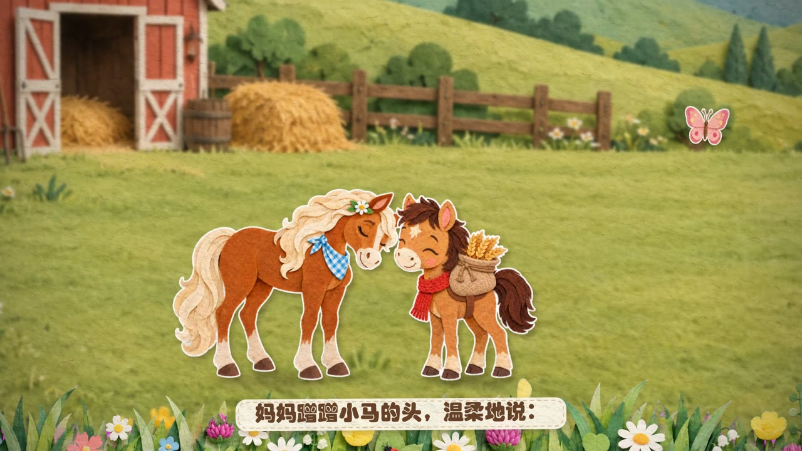
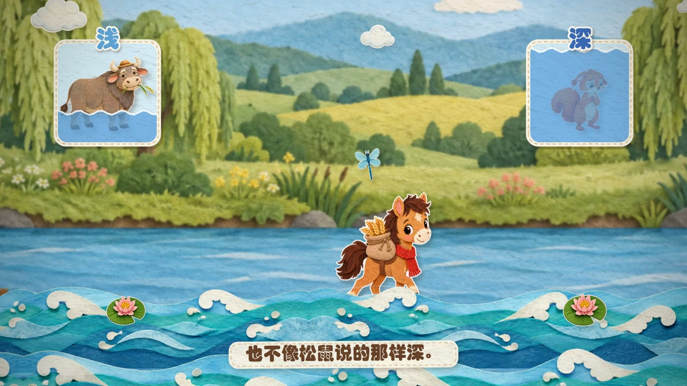
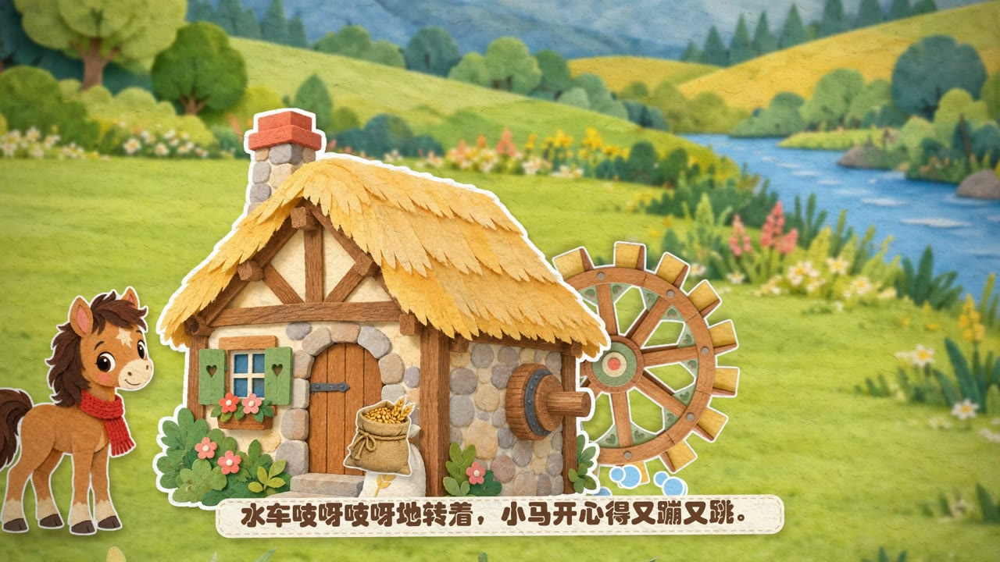
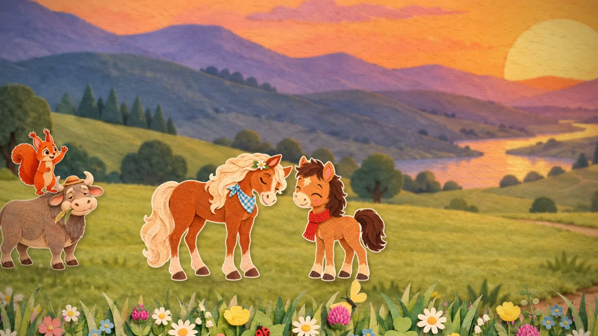

# 小马过河 · 纸艺木偶剧

一部 3 分 39 秒的中文儿童动画短片，讲《小马过河》的故事。画面是纸艺剪纸加毛毡的绘本风格，有温柔女声旁白、字幕和管弦配乐。

整部片子是**程序渲染出来的**，没有用任何动画软件：

- 角色、场景和道具由 AI 生成，动作帧也由 AI 逐帧精修。
- Python 负责其余部分：网格变形、镜头调度、粒子特效和撕纸转场，一帧一帧画出来。
- 配乐用程序编曲，再用 SoundFont 采样音色演奏。

<p align="center">
  
  
</p>

> 🎬 **成片下载**：见本仓库 [Releases](../../releases) 页面（1920×1080，24 fps，3 分 39 秒，约 432 MB）。横版、竖版封面也在 Release 附件里。

| | |
|---|---|
|  |  |
|  |  |
|  |  |
|  |  |

---

## 特点

- **纸偶动画，不是图片平移**
  - 角色是纸片木偶：用网格变形做呼吸和身体弯曲，会自动眨眼，边缘带一点手工制作的轻微抖动。
  - 每个动作都有专门生成的动作帧，按需切换：小跑、奔跑、急停、低头看水、犹豫、提问、受惊、难过、点头、试探着抬蹄、人立欢呼。
  - 动作帧和基准姿势按原画布坐标对齐，切换动作时角色不会跳位。
- **前 3 秒的开场设计**
  - 没有黑场淡入，第 0 帧就是明亮的画面和正在奔跑的小马，标题在 1 秒内弹出。
  - 2.5 秒时旁白提问“小马能过河吗？”，接着老牛和松鼠出场，开场就把故事的矛盾摆出来。
- **零重叠检查**
  - `src/audit.py` 逐帧计算每个元素的屏幕包围盒，检查纸片之间有没有重叠，范围包括角色、飞虫、小鱼、星星、问号、标签文字、标题和字幕。
  - 只算位置不画图，全片约 40 秒跑完。
  - 蝴蝶、蜻蜓、星星会在角色之后再画，靠近角色时自动绕到上方。
- **讲清道理的画面**
  - 讲到“原来河水既不像牛伯伯说的那样浅，也不像松鼠说的那样深”时，小马停在河中央，水刚好到膝盖。
  - 画面两侧同时弹出两张对比卡片：同样的河水只到老牛的蹄子，却能没过松鼠的头顶。
- **音画同步**
  - 全片共用一份时间轴 `src/timeline.py`，按“每幕速度 + 小节数”定义。
  - 画面动作、配乐节拍、旁白入点和字幕都对齐到同一套拍点上。
- **配乐与音效**
  - 每个角色都有自己的音乐动机：小马是轻快的小跑主题，妈妈是温柔的单簧管，老牛是慢悠悠的大管，松鼠是着急的短笛断奏。
  - 过河时每走一步配一下拨弦，加一声踩水声。还有溪水、鱼跳出水面的水花、水车吱呀等音效，全部由程序合成。
  - **刻意不用金属打击乐**（钟琴、铃、三角铁、钢片琴、木琴等）。
  - 旁白出现时，音乐自动压低约 8 dB。
- **旁白**：MiniMax 语音合成，温柔女声，共 40 句，配字幕。

## 分幕

| 幕 | 起始 | 时长 | 内容 |
|---|---|---|---|
| title | 0:00 | 10.0s | 开场：小马飞奔到河边急停，“小马能过河吗？” |
| home | 0:10 | 19.2s | 马棚：妈妈让小马把麦子驮到磨坊 |
| road | 0:29 | 8.0s | 路上小跑，蝴蝶相伴 |
| river | 0:37 | 14.4s | 小河挡路，犹豫 |
| ox | 0:51.6 | 19.2s | 问老牛：水很浅，才到小腿 |
| squirrel | 1:10.8 | 19.2s | 松鼠从树上跳下来拦路：水很深 |
| confused | 1:30 | 16.0s | 听谁的？小马没了主意，往回走 |
| home2 | 1:46 | 37.3s | 妈妈蹭蹭小马的头：自己去试一试 |
| back | 2:23.3 | 14.4s | 回到河边，谢谢松鼠 |
| cross | 2:37.7 | 24.0s | 小心过河：水刚好到膝盖 |
| mill | 3:01.7 | 12.0s | 把麦子送到磨坊 |
| finale | 3:13.7 | 24.0s | 夕阳下回家（圆舞曲） |

---

## 目录结构

```
little-horse/
├── src/
│   ├── timeline.py       # 全片时间轴（每幕速度/小节数、旁白入点、动作拍点）
│   ├── engine.py         # 渲染引擎（素材加载、木偶网格、镜头、粒子、河水、字幕、后期、包围盒登记）
│   ├── scenes.py         # 分镜与动作编排 + 并行渲染入口
│   ├── music.py          # 配乐编曲、音效合成、混响、旁白混音
│   ├── narration.py      # 旁白文稿与语音合成
│   ├── minimax.py        # MiniMax 语音合成接口封装
│   ├── gen_assets.py     # 调用 codex CLI 生成图像素材（含全部提示词）
│   ├── prep.py           # 抠图（绿幕/品红幕）、裁边、拆分道具拼版
│   ├── align.py          # 动作帧与基准姿势对齐，输出洋葱皮核对图
│   ├── audit.py          # 逐帧重叠检查
│   ├── cover.py          # 生成横版/竖版封面
│   ├── filmstrip.py      # 自检：从成片抽帧拼胶片条
│   └── grid.py / contact.py   # 自检：静帧/素材拼图
├── assets/
│   ├── raw/              # AI 生成的原始图（纯色背景）
│   ├── cut/              # 抠图结果 + meta.json / align.json
│   ├── voice/            # 旁白音频（40 句）+ voice.json（文本与时长）
│   └── sf/               # GeneralUser GS 音色库及其许可证
├── docs/
│   ├── screenshots/      # README 截图
│   └── covers/           # 横版、竖版封面
└── pyproject.toml / uv.lock
```

---

## 快速开始：用现成素材重新渲染

仓库里已经带了全部图像素材、抠图结果和旁白音频，**不需要任何 API 密钥**，直接就能渲染。

### 环境要求

| 依赖 | 说明 | 开发时所用版本 |
|---|---|---|
| Python | 3.12 及以上 | 3.12.12 |
| [uv](https://docs.astral.sh/uv/) | Python 包管理 | — |
| [ffmpeg](https://ffmpeg.org/) | 必须在 PATH 中，负责编码和音视频合成 | 8.0.1 |
| 字体 | 字幕和标题用“华文琥珀”，见[字体说明](#字体说明) | — |

Python 依赖有 skia-python、numpy、pillow、scipy、tinysoundfont，具体版本见 `pyproject.toml` / `uv.lock`。

> 本项目在 Windows 11 上开发和验证；macOS / Linux 未测试，可能需要先改字体路径。

### 步骤

```bash
uv sync                                  # 1. 安装依赖
uv run python src/music.py               # 2. 生成配乐（含旁白混音）→ out/music.wav
uv run python src/scenes.py video        # 3. 渲染整片 → out/little_horse.mp4
```

其他用法：

```bash
uv run python src/scenes.py video 0 10           # 只渲染某个时间段（秒）→ out/preview_0_10.mp4
uv run python src/scenes.py still 1.2 125 178.6  # 渲染指定时刻的静帧 → out/still_*.png
uv run python src/audit.py                       # 逐帧重叠检查，问题组合为 0 才算通过
uv run python src/timeline.py                    # 查看时间轴，检查旁白是否超出本幕或互相重叠
uv run python src/cover.py                       # 生成横版/竖版封面 → out/cover_16x9.*、out/cover_9x16.*
uv run python src/filmstrip.py out/little_horse.mp4 0 10 12 out/strip.png   # 抽帧胶片条
```

### 渲染性能

- 整片约 5260 帧（219.2 秒 × 24 fps）。
- 默认开 6 个进程并行，每个进程把帧通过管道交给自己的 ffmpeg，用 libx264 编码（crf 16），最后拼接并合入音频。在开发机（16 GB 内存）上整片约 15 分钟。
- 并行数在 `src/scenes.py` 的 `main()` 中（`workers = 6`）。内存不够就调小，只是更慢，画质不变。
- 配乐生成大约需要 30 秒。

---

## 完整流程：从零生成素材

一般用不到这个流程。只有想换画面、换旁白，或者研究制作方法时才需要。

```
gen_assets.py ──► assets/raw ──► prep.py ──► assets/cut ──► align.py
narration.py ──► assets/voice ──► music.py ──► out/music.wav ──► scenes.py video ──► audit.py 复查
```

### 1. 生成图像（可选，需要 codex CLI）

```bash
uv run python src/gen_assets.py a   # 第一批：角色基准姿势、背景、磨坊、水车、河水前景、道具拼版
uv run python src/gen_assets.py b   # 第二批：基于参考图的姿势（驮口袋的小马、拦路的松鼠）
uv run python src/gen_assets.py c   # 第三批：动作帧（以原图为参考，只改动作）
# 只重新生成某几张：uv run python src/gen_assets.py c pony_worry mom_talk
```

- 需要已登录的 [codex CLI](https://github.com/openai/codex) 并开启图像生成功能，开发时用的是 0.162.1。
- 脚本调用的是 `codex.cmd`（Windows 下的名字，见 `src/gen_assets.py` 的 `run_job`），其他系统要改成 `codex`。
- 已经存在的图会跳过，想重新生成哪张就先删掉它。
- 纸纹、前景草丛、云朵、蝴蝶、小鸟、树叶、星星这几张图沿用自同系列的《三只小猪》，直接放在 `assets/raw` 或 `assets/cut` 里，没有对应的生成任务。
- **重要**：重新生成的图不会和现在的一样。角色大小（`src/engine.py` 的 `SCALE`）、站位、蹭头时的距离（`src/scenes.py` 的 `NUZZLE_X`）、背景取景等参数，都是按现有素材手工调的，换了素材要重新调。

### 2. 抠图与对齐

```bash
uv run python src/prep.py    # 抠图、裁边、拆道具 → assets/cut + meta.json
uv run python src/align.py   # 动作帧对齐 → assets/cut/align.json + out/onion_*.png（洋葱皮核对图）
```

### 3. 旁白（可选，需要 MiniMax 密钥）

```bash
uv run python src/narration.py           # 合成缺失的句子，并重写 assets/voice/voice.json
uv run python src/narration.py samples   # 生成三种候选音色的试听 → out/voice_samples/
uv run python src/minimax.py voices      # 列出可用音色
```

- 文稿在 `src/narration.py` 的 `LINES` 里。`VOICE_ID` 是音色，当前为 `Chinese (Mandarin)_Gentle_Senior`（温柔学姐）；`SPEED` 是语速，当前为 0.9。
- 改了某句文稿，就删掉对应的 `assets/voice/<幕>_<序号>.wav` 再运行，只会重新合成这一句。
- 句子时长变了以后，先运行 `src/timeline.py`，检查有没有句子超出本幕或和下一句重叠，有的话调整 `src/timeline.py` 里 `CUES` 的旁白入点。
- **注意多音字**：语音合成容易把“没过（mò）”这类多音字读错，所以文稿里改成了“才到小腿”“刚好到膝盖”。新增文稿时，尽量避开容易读错的多音字。
- 遇到接口限流（错误码 1002），脚本会自动退避重试。

### 4. 配乐、渲染与复查

按[快速开始](#步骤)的第 2、3 步生成配乐并渲染，再运行 `src/audit.py` 复查有没有重叠。

---

## 配置项

| 配置 | 位置 | 说明 |
|---|---|---|
| `MINIMAX_API_KEY` | 环境变量，或项目根目录的 `.env` 文件（格式 `MINIMAX_API_KEY=...`） | MiniMax 语音合成密钥，只有重新合成旁白时才需要。读取顺序：进程环境变量 → `.env` → Windows 用户级环境变量（注册表 `HKCU\Environment`） |
| `MINIMAX_API_BASE` | 同上 | 可选，接口地址，默认 `https://api.minimax.cn`（国内站） |
| 字幕字体 | `src/engine.py` 的 `FONT_TF` | 默认 `C:/Windows/Fonts/STHUPO.TTF` |
| 并行进程数 | `src/scenes.py` 的 `main()`（`workers`） | 默认 6 |
| 旁白音色 / 语速 | `src/narration.py` 的 `VOICE_ID` / `SPEED` | 见上文 |

## 字体说明

- 标题和字幕用的是“华文琥珀”（`STHUPO.TTF`），代码里直接写死了 Windows 下的路径（`src/engine.py` 的 `FONT_TF`）。
- 这款字体随 Microsoft Office 等软件分发，**有版权，本仓库不包含**。
- 如果机器上没有这款字体，或者要在 macOS / Linux 上运行，就把 `FONT_TF` 改成一款你有权使用的中文字体。
- 可以考虑开源的 [站酷快乐体 ZCOOL KuaiLe](https://fonts.google.com/specimen/ZCOOL+KuaiLe)（SIL Open Font License）。换字体后要检查一遍有没有缺字：华文琥珀就缺“蹚”字，所以文稿里避开了它。

---

## 制作方法要点

- **素材**
  - 所有图都在纯绿（#00FF00）背景上生成；河水、道具用品红背景，方便抠图。
  - 动作帧用“编辑”式提示词，以原图为参考：其余一切不变，只改动作。这样生成的帧可以和原图精确对齐。
- **抠图**
  - 只把和图像边缘相连的强背景色区域判为背景，避免误伤角色身上的同色部分。
  - 再做一圈柔边和去溢色，保留纸片的白色描边。
- **木偶**
  - 用 skia 的三角网格贴图（`skia.Vertices`）做呼吸、弯腰、挤压拉伸。
  - 用 saveLayer + DropShadow 画纸片投影。
- **河水**
  - 毛毡河水前景条分前后两层，以不同速度流动。
  - 相邻两块左右镜像拼接，避免接缝；用网格让水面起伏，盖住涉水小马的腿。
- **后期**：用 numpy 一次叠加纸张纹理和暗角，不走 skia 慢速的全屏混合。

## 致谢与第三方内容

详见 [THIRD_PARTY_NOTICES.md](THIRD_PARTY_NOTICES.md)。

- 图像素材：OpenAI codex CLI 的图像生成功能。
- 旁白：MiniMax 语音合成（speech-2.8-hd）。
- 音色库：[GeneralUser GS](https://www.schristiancollins.com/generaluser)，作者 S. Christian Collins。
